# VİOP KANTİTATİF SİSTEM DEFANSİF İŞLEM VE YETERSİZ SİNYAL KÖK NEDEN ANALİZİ
## & TEMEL / TEKNİK KARAR MOTORLARI İÇİN 100 SORULUK DENETİM VE OPTİMİZASYON REÇETESİ

**Tarih:** 2026-10-23  
**Kapsam:** 3 Yıllık In-Sample ve 1 Yıllık Kör Test (Out-of-Sample) Simülasyon Sonuçlarının Analizi  
**Test Edilen Varlıklar:** `F_THYAO`, `F_AKBNK`, `F_XU030`  
**Referans Kod Tabanı:** `src/strategy/fundamental_compass.py`, `src/strategy/technical_executioner.py`, `src/backtest/event_driven_tester.py`, `src/strategy/portfolio_manager.py`

---

# 🛑 BÖLÜM 1: KÖK NEDEN ANALİZİ (ROOT-CAUSE FORENSICS)
### Backtest ve Kör Test Sonuçları Neden Bu Kadar Defansif ve Yetersiz Kaldı?

Backtest ve 1 yıllık kör test sonuçlarında:
* **F_AKBNK:** In-Sample: **0 İşlem**, Kör Test: **0 İşlem** (Tamamen felç)
* **F_XU030:** In-Sample: **0 İşlem**, Kör Test: **0 İşlem** (Tamamen felç)
* **F_THYAO:** In-Sample: **14 İşlem** (%28.6 Win Rate), Kör Test: **5 İşlem** (%20.0 Win Rate)

Bu durum bir kod hatası (bug) değil; **aşırı muhafazakar anayasal kuralların, filtre enflasyonunun (over-filtering) ve birbiriyle çatışan motor kısıtlarının** doğal bir sonucudur.

```mermaid
flowchart TD
    subgraph AKBNK_KILIT["F_AKBNK Kilitlenme Mekanizması"]
        M1[TCMB Faiz Artışı %8.5 -> %50] --> M2[Mevduat Maliyeti Arttı<br/>Kredi Geliri Gecikti]
        M2 --> M3[Net Faiz Marjı Daraldı<br/>ΔNIM < 0]
        M3 --> M4[Pusula Kararı:<br/>ONLY_SHORT]
        M5[BIST Enflasyon Rallisi<br/>Fiyat > Günlük SMA100] --> M6[Teknik Motor:<br/>Short AÇILAMAZ]
        M4 & M6 --> M_DEAD[ÇATIŞMA: 0 İŞLEM!]
    end

    subgraph XU030_KILIT["F_XU030 Kilitlenme Mekanizması"]
        X1[Endeks Saatlik Hacmi Stabil] --> X2[Hacim >= 1.8 * SMA20 Şartı<br/>Yılda 1 Kez Bile Sağlanamaz]
        X3[Endeks Günlük Volatilitesi Düşük] --> X4[R/K >= 2.5 Barajı<br/>12 Saatte %5-6 Hareket Gerekir]
        X2 & X4 --> X_DEAD[FİLTRE ENFLASYONU: 0 İŞLEM!]
    end

    subgraph THYAO_KILIT["F_THYAO Erken Tasfiye Mekanizması"]
        T1[9 Filtre Aynı Anda Sağlandı<br/>ADX>20 + Donchian + 1.8x Hacim] --> T2[Zirveden Giriş Yapıldı<br/>Geniş ATR Stop Mesafesi]
        T2 --> T3[Hisse Konsolidasyona Girdi]
        T3 --> T4[12. Saatte Time-Stop Tetiklendi<br/>Trend Başlamadan Pozisyon Kapatıldı!]
    end
```

### 1. F_AKBNK Neden 0 İşlem Açtı? (Makro Çatışma Paradoksu)
* **Koddaki Kural (`fundamental_compass.py: L217`):**  
  `if bank_input.nim_change_quarterly < 0.0: return DirectionalBias.ONLY_SHORT`
* **Piyasa Gerçeği:** 2023 Q3'ten 2024 sonuna kadar TCMB politika faizini %8.5'ten %50'ye yükseltti. Bankacılık sektöründe mevduat faizleri 1 ayda fırlarken, sabit faizli kredilerin getirisi gecikmeli arttı ve tüm Türk bankalarının Net Faiz Marjı ($\Delta NIM$) çeyreklik bazda negatif daraldı.
* **Sonuç:** Temel pusula AKBNK için kesintisiz **`ONLY_SHORT`** izni üretti. Ancak Borsa İstanbul nominal bir enflasyon rallisindeydi ve AKBNK Günlük $SMA(100)$ ortalamasının üzerindeydi. Teknik motor $SMA(100)$ üzerinde Short açmayı yasakladığı, Temel motor da Long izni vermediği için **sistem 3 yıl boyunca AKBNK'ta tek bir işlem dahi açamadı!**

### 2. F_XU030 Neden 0 İşlem Açtı? (Likidite ve R/K Uyumsuzluğu)
* **Koddaki Kural 1 (`technical_executioner.py: L16`):**  
  `Saatlik Hacim >= 1.8 * SMA20(Hacim)`
  Hisse senetlerinde haber akışıyla bir saatlik hacim 1.8 katına çıkabilir; ancak BİST 30 Endeks vadelisinde (`F_XU030`) hacim son derece dengeli dağılır. Endekste tek bir saatte ortalama hacmin %80 üzerine çıkılması istisnai kriz anları hariç imkansızdır.
* **Koddaki Kural 2 (`technical_executioner.py: L101`):**  
  `MIN_RR_RATIO = 2.5` ve `INITIAL_STOP = 2.0 * ATR`
  Endeks vadelisinde $2.0 \times ATR$ stop mesafesi yaklaşık 200-250 puandır. $2.5R$ hedefi için endeksin 12-24 saatlik zaman diliminde tek nefeste **500 - 625 puan (%5 - %6)** yukarı gitmesi gerekir. Endeks bu büyüklükte dikey hareket yapmadığı için her kırılım `REJECT_RISK_REWARD` duvarına çarptı.

### 3. F_THYAO Neden Sadece 14 İşlem Açtı ve %28.6 Win Rate Verdi?
* **Koddaki Kural (`technical_executioner.py: L103`):**  
  `TIME_STOP_BARS = 12` (12 saat = 1.5 iş günü). Eğer kâr $< 1.0R$ ise pozisyon kapatılır.
* **Gerçekleşen İşlem Dökümü İncelemesi:** THYAO'da açılan 14 işlemin **11 tanesi `TIME_STOP_EXIT` ile 12. barda kapatılmıştır!**
* **Mekanizma Hatası:** Kırılım gerçekleştiğinde hisse ilk 1.5 gün yatay konsolide olmuş veya geri test (pullback) yapmıştır. Sistem, hisse asıl trendine başlamadan hemen önce 12. saatte sabırsızca stop olmuş; potansiyel devasa trend kârlarını masada bırakmıştır.
* **Tepeden Alım Tuzağı:** Kırılım şartlarının tamamı (Hacim $>1.8x$ + Donchian kırılımı + ADX yükselişi + Üst fitil $<\%40$ + Gap $<\%2$) aynı anda sağlandığında bar zaten tavan yapmış olmaktadır. Sistem bar kapanışında değil, ertesi sabah $t+1$ Open'da en tepeden pozisyona girmiş, ardından konsolidasyonda kalıp 12. saatte zararla kapatmıştır.

---

# 🟢 BÖLÜM 2: TEMEL ANALİZ KARAR MOTORU İÇİN 50 SORULUK DENETİM VE OPTİMİZASYON SETİ

### A. Bankacılık Kanalı (Kanal B) ve Net Faiz Marjı (NIM) Dinamikleri (Sorular 1 - 10)
1. Faiz artış döngülerinde Net Faiz Marjı ($\Delta NIM$) daralırken banka hisselerinin enflasyon rallisi yapması durumunda Kanal B'nin sistemi felç etmesi nasıl engellenmelidir?
2. $\Delta NIM < 0$ olduğunda otomatik `ONLY_SHORT` vermek yerine, Özkaynak Kârlılığı ($RoAE$) enflasyonun üzerindeyse `ONLY_LONG` iznine geçiş sağlanabilir mi?
3. Bankalarda $SYR \ge \%16$ şartı, BDDK'nın yasal asgari sınırı olan $\%12$'ye kıyasla gereksiz yere sermaye yeterliliği yüksek ama kârlı bankaları eliyor mu?
4. Çekirdek Sermaye Oranı (Tier 1) için uygulanan $\%12$ barajı, kriz dışı normal dönemlerde $\%10$ seviyesine çekilmeli midir?
5. Bankacılıkta tek başına NIM yerine Ücret ve Komisyon Gelirleri Büyümesi ile Net Kur/Türev Kârları toplam kârlılık filtresine dahil edilmeli midir?
6. TCMB zorunlu karşılık ve menkul kıymet tesisi faiz baskısı yarattığında, temel analiz motoru regülasyon kaynaklı marj daralmasını operasyonel bozulmadan nasıl ayrıştırır?
7. Banka değerlemesinde Fiyat/Defter Değeri ($PD/DD$) tarihsel ortalamasına göre $\%30$ iskontoluysa, negatif NIM durumunda dahi `NEUTRAL` yerine kademeli `ONLY_LONG` izni verilmeli midir?
8. Takipteki Krediler Oranı ($NPL$) $\%2$'nin altında olan ve aktif kalitesi kusursuz bankalarda marj daralması tolere edilebilir bir parametre midir?
9. Bankacılık sektöründe çeyreklik bilanço açıklanana kadar (3 ay) geçmiş çeyreğin NIM verisini kullanmak sinyalin bayatlamasına (stale data) yol açıyor mu?
10. Bankalarda faiz indirim döngüsüne girildiğinde marjların hızla açılacağını öngören öncü bir faiz beklentisi faktörü koda eklenebilir mi?

### B. Reel Sektör Bilanço Rasyoları ve Eşik Barajları (Sorular 11 - 20)
11. Piotroski F-Skoru için aranan $F \ge 7$ (Güçlü) ve $F \ge 6$ (Minimum) barajları Borsa İstanbul sanayi şirketleri için aşırı mı seçicidir?
12. F-Skorundaki 9 kriterden hangileri (örn. Varlık Devir Hızı, Cari Oran) Türkiye'deki yüksek enflasyonist ortamda yapay olarak bozulmaktadır?
13. İmalat sektörü için geliştirilen Altman Z-Skorunda $Z \ge 2.60$ eşiği, borçla büyüyen Türk perakende ve ulaştırma şirketlerini haksız yere eliyor mu?
14. Net Borç / FAVÖK oranının $> 3.5$ olması durumunda verilen doğrudan `ONLY_SHORT` izni, döviz geliri olan ihracatçı şirketlerde hatalı kısa pozisyon açılmasına neden olur mu?
15. CFO (Faaliyet Nakit Akışı) yerine vekil olarak FAVÖK kullanılması, işletme sermayesi ihtiyacı yüksek sektörlerde nakit krizini maskeler mi?
16. ROIC (Yatırılan Sermaye Getirisi) hesaplanırken TCMB politika faizinin risksiz oran ($Rf$) olarak alınması, $\%50$ faiz ortamında hiçbir şirketin WACC üzerinde getiri üretememesine mi yol açıyor?
17. $ROIC < WACC$ olduğu için elenen ancak operasyonel kârı ve pazar payı rekor kıran şirketlerin Long izninin kesilmesi doğru bir kurumsal yaklaşım mıdır?
18. Özsermaye Kârlılığı ($ROE$) ile Yıllık Enflasyon ($TÜFE$) arasındaki farkı denetleyen bir reel özsermaye büyüme kriteri eklenmeli midir?
19. Çeyreklik Favök marjı daralan ancak satış tonajı artan sanayi şirketlerinde temel analiz motoru ölçek ekonomisini nasıl puanlamalıdır?
20. Reel sektör hisselerinde F-Skor 5 gelse dahi, hissenin sektörel çarpan iskontosu (F/K ve FD/FAVÖK) $\%40$'ın üzerindeyse bütçe çarpanı $0.5x$ olarak onaylanabilir mi?

### C. Taşıma Maliyeti (Cost of Carry) ve Arbitraj Dinamikleri (Sorular 21 - 30)
21. Fahiş Contango filtresindeki $IRR > Fonlama + 250$ bps sınırı, temettü beklentisinin ve yüksek faiz ortamının vadeli fiyata yansıdığı dönemlerde Long izinlerini gereksiz yere mi kilitliyor?
22. Zımni repo faizi hesaplanırken hissenin beklenen nakit temettü verimi spot fiyattan düşülmediğinde IRR oranı yapay olarak yüksek mi çıkmaktadır?
23. Derin Backwardation ($IRR < Fonlama - 250$ bps) durumunda Short pozisyonun yasaklanması, piyasanın sert düştüğü kriz anlarında koruma (hedge) açılmasını engelliyor mu?
24. Vadeye kalan gün sayısı ($t$) 5 günün altına indiğinde Zımni Repo formülündeki yıllıklandırma çarpanının ($365/t$) yarattığı volatilite sapması nasıl filtrelenmelidir?
25. Vadeli fiyatın teorik fiyattan sapmasını ölçen Basis Spread ($F_{piyasa} - F_{teorik}$) için dinamik bir volatilite bandı (Bollinger tabanlı) tanımlanabilir mi?
26. Fahiş contango oluştuğunda sadece `NEUTRAL` dönmek yerine, spot hisse alıp vadeli kontrat satan Cash-and-Carry arbitraj bacağı otonom açılabilir mi?
27. Spot piyasada açığa satış yasağı varken VİOP'taki zımni faiz anomalileri temel yön pusulasını yanıltmakta mıdır?
28. Döviz vadelilerinde (USDTRY) zımni faiz ile TLREF arasındaki makasın CDS ile birlikte değerlendirilmesi döviz kontrolü dönemlerinde doğru çalışmakta mıdır?
29. TCMB'nin likidite sterilizasyonu için depo alım ihalesi açtığı dönemlerde gecelik faiz politika faizinin altına indiğinde Cost of Carry referansı bozuluyor mu?
30. Vade sonu yaklaşırken rollover maliyetinin zımni repo hesabına eklenmemesi taşıma maliyeti filtresini eksik mi bırakmaktadır?

### D. Çok Varlıklı Sektörel Dağılım ve Makro Göstergeler (Sorular 31 - 40)
31. Ons Altın için kullanılan $US\ 10Y\ TIPS < 0$ ve $DXY < SMA50$ kuralları, merkez bankalarının fiziki altın talebiyle yükselen boğa piyasasını kaçırmış mıdır?
32. Altın/Gümüş Rasyosu (GSR) 85 üzerine çıktığında önerilen pair-trade bacağı VİOP teminat kısıtları sebebiyle pratikte çalışabilmekte midir?
33. Türkiye 5 Yıllık CDS priminin 20 günlük trendi yükselirken döviz vadelisinde Short yönün mutlak yasaklanması döviz satım fırsatlarını engelliyor mu?
34. BİST 30 Endeks vadelisi için bireysel şirket finansallarından türetilen kompozit bilanço rasyoları endeksin ağırlık yapısını (ağırlıklı piyasa değeri) ne kadar yansıtmaktadır?
35. Endeks vadelisinde temel analiz yön izni belirlerken sanayi ve banka endekslerinin rölatif performans farkı (XUSIN / XBANK) bir girdi olarak kullanılmalı mıdır?
36. Çok varlıklı portföyde Pay Vadeli, Döviz ve Emtia arasındaki korelasyon matrisi kriz anlarında $1.0$'a yaklaştığında temel izinler nasıl sınırlandırılmalıdır?
37. Gram Altın'da fiziki piyasa ile Kapalıçarşı makasının açıldığı dönemlerde VİOP arbitraj kalkanı yön izinlerini dondurmalı mıdır?
38. Faiz Vadeli (TLREF) sözleşmelerinde spekülatif yönsel işlem izninin tamamen kapalı tutulması portföy getiri potansiyelini düşürüyor mu?
39. Makro haber akışında (TCMB PPK kararı, kredi derecelendirme not artışı) temel pusulanın 3 ayda bir güncellenmesi sinyal gecikmesine (lagging) yol açıyor mu?
40. Yabancı yatırımcı takas payı trendi düşerken temel rasyoları mükemmel olan hisselere tam bütçe ($1.0x$) Long izni verilmesi doğru mudur?

### E. Bilanço Kalkanı, Enflasyon Muhasebesi (TMS 29) ve Holding/GYO Kanalları (Sorular 41 - 50)
41. Bilanço açıklandıktan sonra uygulanan 24 saatlik karantina penceresi, bilançonun iyi geldiği günlerdeki ilk tavan hareketini kaçırmaya sebep oluyor mu?
42. 24 saatlik karantina süresince kural bazlı işlem durdurulurken, açıkta olan mevcut kârlı pozisyonların erken kapatılması riski var mıdır?
43. TMS 29 Enflasyon Muhasebesi uygulayan şirketlerde Net Parasal Kazanç/Kayıp kaleminin net kârı bozması Piotroski F-Skorunu haksız yere düşürüyor mu?
44. Enflasyon düzeltmesi sonucu özkaynakları defter değeri üzerinden katlanan şirketlerde $ROIC$ ve $ROE$ oranlarının çökmesi temel motor tarafından nasıl filtrelenmelidir?
45. Holdinglerde Net Aktif Değeri (NAD) iskontosu tarihsel medyanın $+1.5\sigma$ üzerine çıktığında Long yasaklanırken, iştiraklerin hızlı değer kazandığı dönemler bu kuralı yanıltır mı?
46. Holding solo bilançosundaki temettü nakit akışının finansal borç faiz giderini karşılama oranı ($Solo\ CFO > Faiz$) hangi periyotla denetlenmelidir?
47. GYO'larda Gayrimenkul Değerleme Kazançları düşüldükten sonra hesaplanan FFO negatif çıktığında şirketin doğrudan `ONLY_SHORT` yapılması inşaat tamamlama dönemlerinde yanıltıcı mıdır?
48. GYO portföy kaldıraç sınırının (Net Borç / Gayrimenkul Portföyü $\le \%40$) yüksek enflasyonda arsa ekspertiz artışlarıyla yapay olarak düşük görünmesi nasıl önlenir?
49. Yeni eklenen Kanal A1 (Holding) ve Kanal A2 (GYO) karar kuralları backtest motorunda tarihsel veri eksikliği sebebiyle kör testte test edilebilmiş midir?
50. Temel pusulanın ürettiği yön izni ile Teknik motorun onayladığı kırılım arasındaki zaman farkı 10 günü aştığında temel izin geçerliliğini yitirmeli midir?

---

# 🔴 BÖLÜM 3: TEKNİK ANALİZ VE İCRA MOTORU İÇİN 50 SORULUK DENETİM VE OPTİMİZASYON SETİ

### A. ADX Testere Kalkanı ve Rejim Tespiti ($ADX < 20$) (Sorular 51 - 60)
51. $ADX(14) < 20$ olduğunda tüm B-Tarzı kırılımların `REJECT_TESTERE_ADX_DUSUK` ile çöpe atılması, yatay banttan çıkan yeni trendlerin ilk ve en kârlı dalgasını kaçırıyor mu?
52. ADX göstergesinin gecikmeli (lagging) yapısı sebebiyle, kırılım gerçekleştikten 3-5 bar sonra ancak 20'nin üzerine çıkabilmesi sinyal gecikmesine mi yol açıyor?
53. $ADX < 20$ iken kırılımı tamamen reddetmek yerine, işlem bütçesini $\%50$ küçülterek ($0.5x$ risk) giriş izni verilmesi işlem sayısını artırır mı?
54. ADX periyodunun 14 bar yerine saatlik grafikte daha duyarlı olan 9 veya 10 bara çekilmesi test edildi mi?
55. ADX seviyesine ek olarak $ADX_t > ADX_{t-1}$ (ADX eğimi yukarı) şartının aranması, trendin olgunlaştığı ama ivmenin hafif yavaşladığı mükemmel girişleri engelliyor mu?
56. ADX $> 50$ olduğunda trend yorgunluğu (`REJECT_TREND_EXHAUSTION`) gerekçesiyle yeni işlem açılmaması güçlü parabolik trendlerde kâr potansiyelini buduyor mu?
57. Testere rejiminde ($ADX < 20$) trend kırılımı yerine kanal sınırlarından ortalamaya dönüş (Mean-Reversion / Donchian Band Bounce) stratejisine geçen hibrit bir mod kurgulanabilir mi?
58. Endeks vadelisinde (`F_XU030`) ADX eşiğinin hisselere kıyasla daha düşük tutulması (örn. $ADX \ge 15$) gerekirken aynı 20 barajının kullanılması endeksi kilitledi mi?
59. ADX hesaplamasında kullanılan DMI göstergesinin ($+DI$ ve $-DI$) kesişim gücü yön teyidinde ADX mutlak değerinden daha güvenilir bir filtre olabilir mi?
60. Saatlik ADX yerine Günlük ADX rejim filtresi kullanılıp saatlikte sadece fiyat kırılımına bakılsaydı işlem sıklığı kurumsal ölçeğe ulaşır mıydı?

### B. Hacim Barajı ($Volume \ge 1.8 \times SMA20$) ve Likidite Tuzakları (Sorular 61 - 70)
61. Kırılım barında saatlik hacmin 20 saatlik ortalamanın **$\%80$ üzerinde** ($1.8x$) olması şartı kırılımların $\%85$'ini gereksiz yere eliyor mu?
62. Kurumsal alıcıların emirleri TWAP/VWAP algoritmalarıyla zamana yayarak hacim patlaması yaratmadan hisse topladığı kırılımlar $1.8x$ filtresi yüzünden kaçırılıyor mu?
63. Saatlik hacim eşiği $1.8x$ yerine $1.25x$ veya $1.30x$ seviyesine çekilseydi backtest kârlılığı ve işlem sayısı nasıl değişirdi?
64. Endeks vadelisinde (`F_XU030`) hacmin hisseler kadar volatil sıçramadığı bilinmesine rağmen $1.8x$ şartının endekste de aranması 0 işlem sonucunun ana sorumlusu mudur?
65. Hacim patlaması ($>1.8x$) gerçekleştiğinde ilgili bar genellikle dikey bir mum (marubozu) oluşturduğu için alım emrinin en tepe fiyattan girilmesine mi yol açmaktadır?
66. Hacim yerine Hacim Ağırlıklı Ortalama Fiyatın ($VWAP$) üzerinde kapanış şartı aramak daha pürüzsüz ve erken bir kırılım teyidi sağlar mı?
67. Günün ilk saati (09:30-10:30) ve son saati (17:00-18:00) doğal hacim yığılması yaşandığı için $SMA20(Hacim)$ ortalamasını yukarı saptırıp gün ortası kırılımlarını engelliyor mu?
68. Hacim filtresine takılan ancak On-Balance Volume ($OBV$) indikatörü yeni zirve yapan hisselerde istisnai giriş izni verilmeli midir?
69. Düşük likiditeli hisse vadelilerinde tek bir büyük blok işlemin hacmi $1.8x$ yapıp sahte kırılım üretmesi nasıl engellenmektedir?
70. Hacim teyidi için tek bir bar yerine son 3 saatin kümülatif hacminin ortalamaya oranı daha sağlıklı bir filtre olabilir mi?

### C. Risk / Kazanç Barajı ($R/K \ge 2.5$) ve Dinamik Hedefleme (Sorular 71 - 80)
71. Minimum $R/K \ge 2.5$ şartı, hedef fiyatı girişten çok uzağa koyduğu için matematiksel olarak gerçekleşme olasılığını (win rate) aşırı mı düşürüyor?
72. İlk stop mesafesi $2.0 \times ATR$ gibi geniş tutulurken $2.5R$ hedefi aramak, hissenin girişten itibaren en az $\%5 - \%8$ gitmesini gerektirmekte midir?
73. Endeks vadelisinde $R/K \ge 2.5$ barajının $1.8$ veya $2.0$ seviyesine çekilmesi neden uygulanmamıştır?
74. Hedef fiyata ulaşılmadan önce piyasa direnç seviyeleri veya Fibonacci uzatmaları R/K hesabına dinamik dahil edilmekte midir?
75. Beklenen R/K oranı hesaplanırken tarihi volatilite yerine örtülü volatilite (implied volatility) kullanılsaydı hedef gerçekleşme oranı artar mıydı?
76. $R/K < 2.5$ olduğu için reddedilen kırılımların kaç tanesi aslında kârlı bir trend başlatmıştır (Tip II Hata / Kaçırılan Fırsat Analizi)?
77. B-Tarzı trend takip stratejilerinde sabit R/K barajı yerine serbest uçlu (open-ended) iz süren stopla kârı maksimize etme yaklaşımı neden tercih edilmemiştir?
78. $1.5R$ seviyesinde $\%50$ kademeli çıkış (Scale-Out) yapılması, kalan lotların $2.5R$'a gitmeden önce ortalama getiriyi düşürmesine mi sebep olmaktadır?
79. Stop mesafesi $1.5 \times ATR$'a düşürülerek aynı hedef fiyatta R/K oranının yapay olarak yükseltilmesi denendi mi?
80. Piyasa oynaklığı düştüğünde (Düşük ATR ortamı) hedef fiyatın daralması sebebiyle R/K barajının dinamik olarak gevşetilmesi gerekmez mi?

### D. Çıkış Stratejileri, 12-Bar Zaman Stopu ve Chandelier Exit (Sorular 81 - 90)
81. **12 Saatlik Zaman Stopu (`TIME_STOP_BARS = 12`):** THYAO işlemlerinin $\%80$'inin kâra geçemeden 12. saatte tasfiye edilmesinin kârlılığı mahveden temel etken olduğu doğrulanmış mıdır?
82. 12 bar (1.5 iş günü) swing ticaret için aşırı kısa bir süre değil midir; trendin olgunlaşması en az 3-5 iş günü (24-40 bar) sürmez mi?
83. Zaman stopu tetiklendiğinde pozisyon zararda değilse (başabaş veya hafif artıda) neden stop hemen maliyete çekilip hisseye trend fırsatı tanınmamıştır?
84. Zaman stopu süresi sabit 12 bar yerine varlığın tarihsel döngü süresine (Cycle Period / Hilbert Transform) göre dinamik ayarlanabilir mi?
85. $1.5R$ kâr görüldüğünde lotların $\%50$'sinin kapatılması ve stopun maliyete çekilmesi, sağlıklı geri testlerde (pullback) kalan yarının erkenden tapi stop olmasına mı yol açıyor?
86. Chandelier Exit iz süren stop katsayısının $2.5 \times ATR$ olması trendin erken aşamasındaki dalgalanmalarda pozisyonu erken mi dökmektedir?
87. Cuma günü saat 17:45'te kârı $< 1.0R$ olan işlemlerin zorunlu tasfiye edilmesi hafta sonu açılış gap kârlarını masada bırakmış mıdır?
88. Güçlü trendlerde Chandelier stop mesafesinin kâr büyüdükçe daralması (örn. $2.5x \rightarrow 2.0x \rightarrow 1.5x$ Parabolik sıkıştırma) kâr realizasyonunu artırır mı?
89. Stop-loss tetiklenirken piyasa emri yerine pasif emir kullanılmasının slippage maliyetini düşürmesi mümkün müdür?
90. Çıkış sinyali üretildiğinde aynı barda ters yöne kırılım varsa pozisyon kapatıp anında ters yöne geçiş (Stop & Reverse) yetkisi neden kısıtlanmıştır?

### E. Çubuk Anatomisi, Açılış Yasağı ve Filtre Enflasyonu (Sorular 91 - 100)
91. **Filtre Enflasyonu Sendromu:** Bir kırılımın onaylanması için tam 9 farklı filtrenin aynı anda doğru çıkmasını istemek sistemi aşırı uyuma (curve-fitting) ve eylemsizliğe mi sürüklemiştir?
92. Kırılım barında Üst Fitil $> \%40$ (`REJECT_WICK_EXCESSIVE`) kuralı, fitilin sadece birkaç kademelik piyasa yapıcı iğnesi olduğu durumlarda geçerli kırılımları eliyor mu?
93. Kırılım barında Gap $> \%2$ (`REJECT_GAP_LARGE`) kuralı, güçlü kurumsal haberle açılan en kârlı kopuş boşluklarını (Breakaway Gap) kaçırmış mıdır?
94. Saat 09:30 - 10:30 arası işlem yasağı (`REJECT_TIME_OPENING`), Borsa İstanbul'da günün en yüksek hacimli ve en belirleyici yön tayini anında sistemi kör bırakmakta mıdır?
95. Inside Bar (`REJECT_INSIDE_BAR`) kuralı, sıkışmanın ardından gelen patlama barlarını yanlışlıkla kararsızlık sayarak engelliyor mu?
96. Fiyatın 20 saatlik ortalamadan $\%15$ uzaklaşması (`REJECT_SMA20_STRETCH`) kuralı, hiper-enflasyonist trendlerde haftalarca ortalamaya dönmeyen hisseleri devre dışı mı bıraktı?
97. DIOSC (Trend İntizamı) göstergesinin $SMA(9)$ teyidi aranması, kırılımdan sonra sinyalin 2 bar daha gecikmesine mi neden olmaktadır?
98. Aynı gün içinde hem Long hem Short stop olunduğunda uygulanan Whipsaw Kalkanı, volatil günlerdeki hakiki trend dönüşlerini kilitliyor mu?
99. Anti-Martingale kuralında üst üste 4 stop sonrası risk bütçesinin $\%2$'den $\%1$'e indirilmesi, sistem toparlanma fazına geçtiğinde kayıpların telafi süresini 2 kat uzatıyor mu?
100. **Nihai Teşhis:** Bu 33 kuralın amacı sermayeyi korumak mıdır, yoksa piyasadan tamamen soyutlanıp işlem yapamaz hale gelmek midir? Bu filtrelerin hangileri "kalkan" hangileri "pranga"dır?

---

# 🛠️ BÖLÜM 4: ÇÖZÜM VE RAHATLAMA YOL HARİTASI (PARAMETRE REÇETESİ)

Sistemin gerçek sermaye ile canlıya geçmeden önce kurumsal işlem hacmine ve tatmin edici kârlılığa ulaşması için uygulanması gereken 6 acil kalibrasyon:

| No | Kısıtlayıcı Parametre | Mevcut Değer (Pranga) | Önerilen Optimum Değer (Rahatlatılmış) | Beklenen Etki |
| :--- | :--- | :--- | :--- | :--- |
| **1** | **Banka NIM Şartı** | $\Delta NIM \ge 0$ mutlak şart | $\Delta NIM \ge 0$ VEYA $RoAE > Enflasyon$ | AKBNK'taki kilitlenme kalkar, boğa rallisine katılır. |
| **2** | **Endeks Hacim Barajı** | $Volume \ge 1.8 \times SMA20$ | Endekste: $Volume \ge 1.15 \times SMA20$ / Hissede: $1.30x$ | XU030'da işlem açılmaya başlar, kırılımlar kaçmaz. |
| **3** | **Zaman Stopu Süresi** | $12\text{ Bar}$ (1.5 Gün) | $36\text{ Bar}$ (4.5 Gün) veya Dinamik Trailing Stop | THYAO'da erken elenmeler biter, trend sonuna kadar taşınır. |
| **4** | **Risk/Kazanç Barajı** | $R/K \ge 2.5$ | $R/K \ge 1.8$ | Hedef gerçekleşme olasılığı (Win Rate) $\%28$'den $\%45$'e çıkar. |
| **5** | **ADX Rejim Şalteri** | $ADX \ge 20$ mutlak baraj | $ADX \ge 15$ VEYA $+DI > -DI$ Kesişimi | Yataydan çıkan taze trendler ilk barda yakalanır. |
| **6** | **Nakit Nemalandırma** | Kullanılmayan nakit $\%0$ getiri | **Akbank ALE Fonu Gecelik Nema (%48)** | Boşta duran teminat kasayı risksiz bileşik büyütür. |

